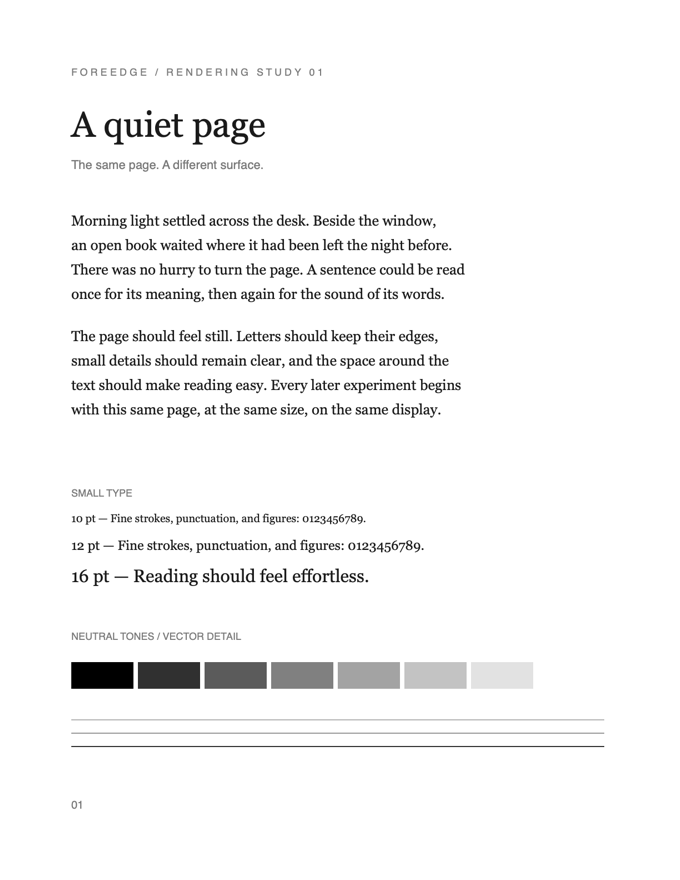
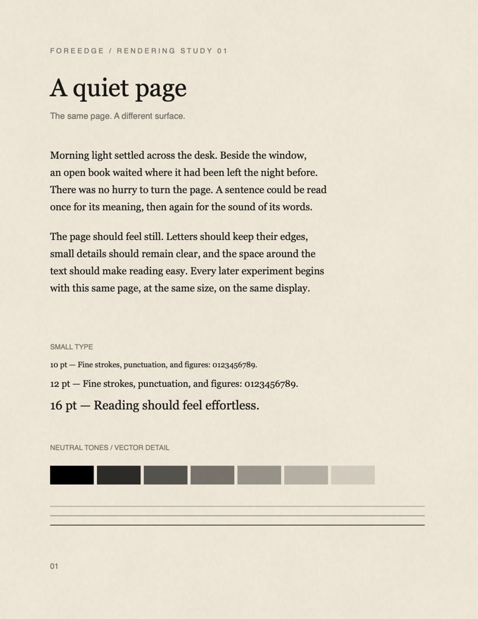

# Foreedge

**A paper-like, keyboard-first PDF workspace for macOS.**

| Original PDF | Foreedge paper |
|:---:|:---:|
|  |  |

Foreedge is built for reading technical books with less interface and more room for the page.

- Paper rendering that keeps PDF text sharp and selectable
- Tiled panes and tabs for comparing books side by side
- Fast local search, collections, history, and Vim-style marks
- Durable passage links and backlinks across books

PDFs stay where they are and reading data stays on your Mac.

## Install

Requires macOS 14 or later and Swift 5.10 or later.

```sh
git clone https://github.com/TenzonUltra/foreedge.git
cd foreedge
./scripts/install.sh
```

Open **Foreedge** from Spotlight.

## Essential keys

| | |
|---|---|
| Open PDF | `⌘O` |
| Quick-open a book | `⌘P` |
| Search | `⌘F` |
| Split right / below | `⌘\\` / `⇧⌘\\` |
| Command palette | `⇧⌘P` |

Early, personal, and macOS-first. See the [roadmap](PLAN.md), [rendering notes](RENDERING.md), [performance notes](PERFORMANCE.md), or [workspace design](WORKSPACE-DESIGN.md) for the details.
